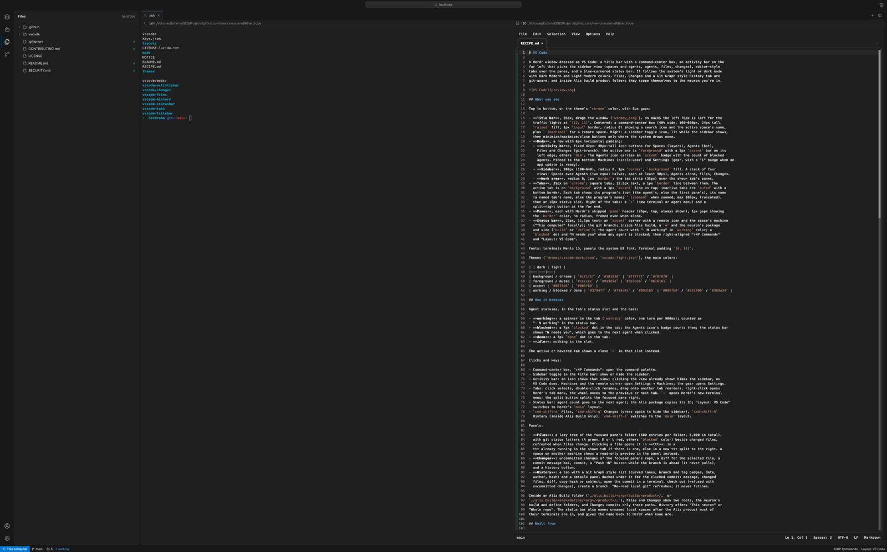
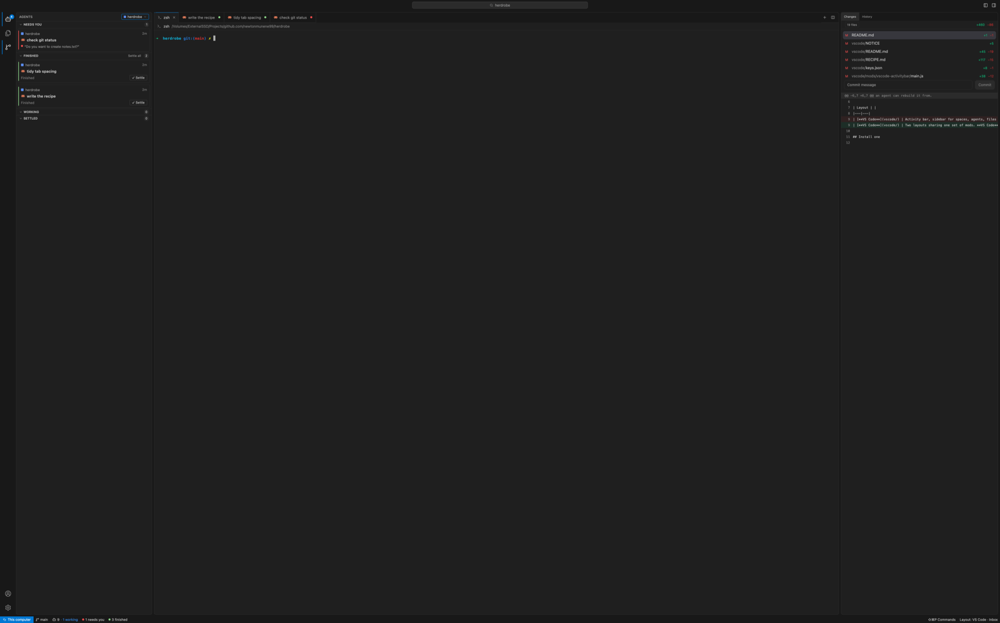

# VS Code

Two [Herdr](https://herdr.dev) layouts dressed as VS Code, sharing one set of mods. Both follow
your system's light or dark mode.

- **VS Code**: title bar with a command center, activity bar, a sidebar for spaces, agents,
  files and changes, editor-style tabs, a Git Graph style history, and a blue-cornered status bar.
- **VS Code · Inbox**: the same window built around agents that need you. The sidebar sorts every
  agent into **Needs you**, **Finished**, **Working** and **Settled**, and a finished agent stays
  there until you settle it, instead of vanishing the moment you glance at it. Changes and History
  sit in a right sidebar that follows whichever agent you pick.



## Install

Paste this to any coding agent (Claude Code, Codex, ...) running on the machine with Herdr:

```
Run `herdr-app --skill` and read the guide it points to, then add this layout: github.com/newtonmunene99/herdrobe/tree/main/vscode
```

`herdr-app --skill` is Herdr's manual for agents. It sends them to the `AGENTS.md` in your Herdr
folder (wherever it is), which says how to install a layout safely: read everything first, never
overwrite your files, merge the keys, and check each mod.

By hand: copy `layouts/vscode*` to `~/.config/herdr-app/layouts/`, each `mods/vscode-*` folder
to `~/.config/herdr-app/mods/`, `themes/vscode-*.json` to `~/.config/herdr-app/themes/`, and
merge `keys.json` into yours. Then pick one with `ctrl-shift-l` or Settings → Look.

## Needs

- **macOS.** Keys use `cmd`, copying uses `pbcopy`. Most of it works elsewhere; see
  [RECIPE.md](RECIPE.md#watch-out).
- **git**, for Files, Changes and History.
- **[ttt](https://tttedit.dev)** for opening files from the Files panel:
  `brew install eugenioenko/ttt/ttt`, with `"reuseWindow": true` in
  `~/.config/ttt/settings.json` so clicks reuse one editor.

**What the mods run:** `git` (status, diff, commit, push, log, checkout, branch), `sh`, `pbcopy`,
`ttt` and `hc` (to read a waiting agent's question off its screen). Nothing reaches the network
except `git push`, and only when you click Push.

## VS Code · Inbox



- **Needs you**: agents waiting for an answer, as cards showing the question they're asking.
- **Finished**: agents that finished while you weren't looking. They stay until you click
  **✓ Settle** (or **Settle all**), or until you've had one selected, with the window in front,
  for 5 seconds. New work brings a settled agent back.
- **Working** and **Settled**: one row each.
- **Spaces** live in the sidebar's `All spaces ⌄` dropdown: pick one to see its agents and go
  there, right-click for Rename, Close and worktrees, or make a new space, open a folder as one,
  or start a worktree.
- The tabs' green dot, the status bar's "N finished" and the Agents badge all count the same
  Finished list.

The status bar keeps that list in both layouts (it is on screen from launch), so a finish isn't
missed while you're in **VS Code** or have the sidebar on Files.

## Keys

| Key | VS Code | VS Code · Inbox |
|---|---|---|
| `cmd-shift-a` | | Agents (again: hide the sidebar) |
| `cmd-shift-e` | Files (again: hide the sidebar) | Files |
| `cmd-shift-g` | Changes (again: hide the sidebar) | Changes, in the right sidebar |
| `cmd-shift-h` | History for the current workspace context | History, in the right sidebar |
| `cmd-shift-l` | Pick a layout | Pick a layout |

"Layout: …" in the status bar opens the same layout picker, listing every layout, Herdr's own
included.

## Workspace contexts

Out of the box, Files and Changes behave like Herdr's own panels. If your projects have a
structure worth showing (one feature spread over two repos, say), edit `context.js` in
`vscode-files`, `vscode-changes`, `vscode-statusbar` and `vscode-history` (four identical
copies): for a folder it can return extra folder roots for Files and Changes, the repos and a
folder scope for History, a status bar badge, and a name for the space. The shape is documented
at the top of the file.

## Updating and removing

Herdr never updates layouts or mods from others. To update, overwrite your copies of the files
above with this folder's latest; your `keys.json` stays yours.

To remove both layouts, switch to another layout first, then delete `layouts/vscode*` from
`~/.config/herdr-app`, the `mods/vscode-*` folders, `themes/vscode-*.json`, and the
`layout:vscode` and `layout:vscode-inbox` sections of your `keys.json`. Herdr's own layouts are
untouched throughout.

## License

Apache 2.0. `vscode-files` and `vscode-changes` started as copies of Herdr's own `files` and
`changes` mods, and `vscode-agents` copies the picker's space colours; see [NOTICE](NOTICE).
