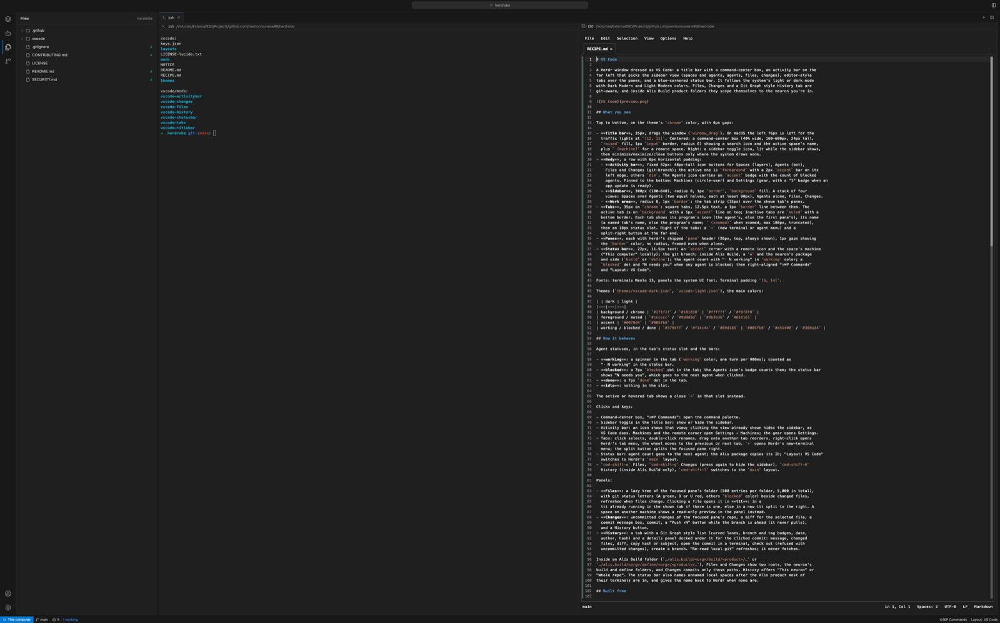
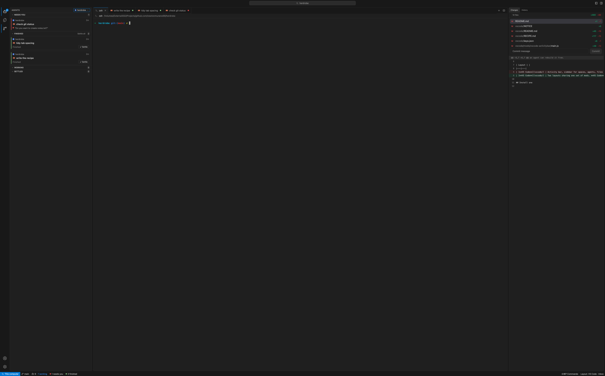

# VS Code

A Herdr window dressed as VS Code: a title bar with a command-center box, an activity bar on the
far left that picks the sidebar view (spaces and agents, agents, files, changes), editor-style
tabs over the panes, and a blue-cornered status bar. It follows the system's light or dark mode
with Dark Modern and Light Modern colors. Files, Changes and a Git Graph style History tab are
git-aware, and a small hook (`context.js`) lets them show extra structure for folders you teach
it about.



## What you see

Top to bottom, on the theme's `chrome` color, with 6px gaps:

- **Title bar**, 35px, drags the window (`window_drag`). On macOS the left 76px is left for the
  traffic lights at `[12, 11]`. Centered: a command-center box (40% wide, 160–600px, 24px tall,
  `raised` fill, 1px `input` border, radius 6) showing a search icon and the active space's name,
  plus ` [machine]` for a remote space. Right: a sidebar toggle icon, lit while the sidebar shows,
  then minimize/maximize/close buttons only where the system draws none.
- **Body**, a row with 6px horizontal padding:
  - **Activity bar**, fixed 42px: 48px-tall icon buttons for Spaces (layers), Agents (bot),
    Files and Changes (git-branch); the active one is `foreground` with a 2px `accent` bar on its
    left edge, others `dim`. The Agents icon carries an `accent` badge with the count of blocked
    agents. Pinned to the bottom: Machines (circle-user) and Settings (gear, with a "1" badge when an
    app update is ready).
  - **Sidebar**, 300px (180–640), radius 8, 1px `border`, `background` fill. A stack of four
    views: Spaces over Agents (two equal halves, each at least 90px), Agents alone, Files, Changes.
  - **Work area**, radius 8, 1px `border`: the tab strip (35px) over the shown tab's panes.
- **Tabs**, 35px on `chrome`: square tabs, 12.5px text, a 1px `border` line between them. The
  active tab is on `background` with a 1px `accent` line on top; inactive tabs are `muted` with a
  bottom border. Each tab shows its program's icon (the agent's, else the first pane's), its name
  (a named tab's name, else the program's name; ` (zoomed)` when zoomed, max 180px, truncated),
  then an 18px status slot. Right of the tabs: a `+` (new terminal or agent menu) and a
  split-right button at the far end.
- **Panes**, each with Herdr's shipped `pane` header (26px, top, always shown), 1px gaps showing
  the `border` color, no radius, framed even when alone.
- **Status bar**, 22px, 11.5px text: an `accent` corner with a remote icon and the space's machine
  ("This computer" locally); the git branch; a workspace context's badge, if `context.js`
  gives the focused folder one; the agent count with "· N working" in `working` color; a
  `blocked` dot and "N needs you" when any agent is blocked; then right-aligned "⇧⌘P Commands"
  and "Layout: VS Code".

Fonts: terminals Menlo 13, panels the system UI font. Terminal padding `[6, 14]`.

Themes (`themes/vscode-dark.json`, `vscode-light.json`), the main colors:

| | dark | light |
|---|---|---|
| background / chrome | `#1f1f1f` / `#181818` | `#ffffff` / `#f8f8f8` |
| foreground / muted | `#cccccc` / `#9d9d9d` | `#3b3b3b` / `#616161` |
| accent | `#0078d4` | `#005fb8` |
| working / blocked / done | `#3794ff` / `#f14c4c` / `#89d185` | `#005fb8` / `#e51400` / `#388a34` |

## How it behaves

Agent statuses, in the tab's status slot and the bars:

- **working**: a spinner in the tab (`working` color, one turn per 900ms); counted as
  "· N working" in the status bar.
- **blocked**: a 7px `blocked` dot in the tab; the Agents icon's badge counts them; the status bar
  shows "N needs you", which goes to the next agent when clicked.
- **done**: a 7px `done` dot in the tab.
- **idle**: nothing in the slot.

The active or hovered tab shows a close `✕` in that slot instead.

Clicks and keys:

- Command-center box, "⇧⌘P Commands": open the command palette.
- Sidebar toggle in the title bar: show or hide the sidebar.
- Activity bar: an icon shows that view; clicking the view already shown hides the sidebar, as
  VS Code does. Machines and the remote corner open Settings → Machines; the gear opens Settings.
- Tabs: click selects, double-click renames, drag onto another tab reorders, right-click opens
  Herdr's tab menu, the wheel moves to the previous or next tab. `+` opens Herdr's new-terminal
  menu; the split button splits the focused pane right.
- Status bar: agent count goes to the next agent; a context badge copies its value; "Layout: VS Code"
  opens a popup of every layout, Herdr's own included, current one ticked; picking switches.
- `cmd-shift-e` Files, `cmd-shift-g` Changes (press again to hide the sidebar), `cmd-shift-h`
  History (when a workspace context provides it), `cmd-shift-l` opens the layout popup.

Panels:

- **Files**: a lazy tree of the focused pane's folder (500 entries per folder, 5,000 in total),
  with git status letters (A green, D or U red, others `blocked` color) beside changed files,
  refreshed when files change. Clicking a file opens it in **ttt**: in a
  ttt already running in the shown tab if there is one, else in a new ttt split to the right. A
  space on another machine shows a read-only preview in the panel instead.
- **Changes**: uncommitted changes of the focused pane's repo, a diff for the selected file, a
  commit message box, commit, a "Push ↑N" button while the branch is ahead (it never pulls),
  and a History button.
- **History**: a tab with a Git Graph style list (curved lanes, branch and tag badges, date,
  author, hash) and a details panel docked under it for the clicked commit: message, changed
  files, diff, copy hash or subject, open the commit in a terminal, check out (refused with
  uncommitted changes), create a branch. "Re-read local git" refreshes; it never fetches.

**Workspace contexts.** Each of Files, Changes, the status bar and History asks
`context.js` whether the focused folder has a workspace context. The published copy always says
no, so they behave as described above everywhere. A personal copy can return extra folder roots
(Files and Changes show one section each, and Changes commits only paths under each), History
repos with a folder scope ("This folder" or its own label, beside "Whole repo") and tag
prefixes, and a status bar badge that copies a value on click. The shape is documented at the
top of `context.js`. Separately, the status bar calls `nameSpaces()` from `naming.js` every two
seconds; the published copy does nothing, and a personal one may name spaces.

## Built from

Layout tree (`layouts/vscode.json`), root a column with `"titlebar": "none"`:

```
root (column, gap 6, background chrome)
├─ titlebar   block 35px, window_drag          → vscode-titlebar
├─ body       row, gap 6, padding [0, 6]
│  ├─ activitybar  block 42px (min = max = 42) → vscode-activitybar
│  ├─ sidebar      column 300px (180–640), radius 8, border, background
│  │  └─ sidebar-body  stack, active "spaces-view"
│  │     ├─ spaces-view  column: spaces (weight 1, min 90) → spaces; agents (weight 1, min 90) → agents
│  │     ├─ agents-view  block → agents
│  │     ├─ files        block → vscode-files
│  │     └─ changes      block → vscode-changes
│  └─ work         column, resizable false, radius 8, border, background
│     ├─ tabs  block 35px → vscode-tabs
│     └─ main  block, background border, { tab: "active" }, pane frame:
│              gap 1, radius 0, background, lone true, header { mod: "pane", 26px, top, always }
└─ statusbar  block 22px → vscode-statusbar
```

Mods in this folder:

- `vscode-titlebar`: reads `spaces()`, `layout()`, `window()`; runs `app.palette`,
  `layout.toggle {id: "sidebar"}` (and `{id: "secondary"}` when the layout has it), `window.*`.
- `vscode-activitybar`: shows only the views the layout's stacks hold; switches them with
  `layout.select {stack, child}` and `layout.show` / `layout.hide {id}` on `sidebar` (or `secondary`);
  takes `files`, `changes`, `history`, `agents`, `spaces` from `nextCommand()`.
- `vscode-tabs`: `spaces()`, `panes()` (program icons); `tab.select`, `tab.move`, `tab.rename`,
  `tab.close`, `tab.next`/`tab.prev`, `pane.split`; opens the shipped `menu` and `new-menu` mods
  as popups.
- `vscode-statusbar`: `agents()`, `focused()`, `shared("layout")`; `agent.next`,
  `app.settings {section: "machines"}`, `layout.switch {name}` from its layout popup (a second
  copy of itself, props `{layoutMenu: true}`); takes `history` and `layouts` from
  `nextCommand()`; runs `naming.js`'s `nameSpaces()` every 2 s (a no-op here). It also keeps the
  Finished record for VS Code · Inbox (shared `vscode.inbox`, below) in both layouts.
- `vscode-files` (cloned from Herdr's `files`): `exec` (`sh`, `git status`, PowerShell on
  Windows), `readTextFile`, `watchFolder`, `hc get` (to find a running ttt), `pane.split` /
  `tab.new` with `argv: ["ttt", "--new-window", path]`.
- `vscode-changes` (cloned from Herdr's `changes`): `exec("git", …)` for status, diff, add,
  commit and push; `watchFolder`.
- `vscode-history`: `exec("git", …)` (log, show, switch, checkout, branch), a second copy of
  itself as a dialog for checkout and branch, `notify`, `pane.split` with `git show`. With props
  `{follow: true}` it shows the focused pane's repo instead (used by VS Code · Inbox).
- `context.js` (identical in files, changes, statusbar, history): the workspace-context hook;
  `contextFor(path)` returns null here, and `openHistory()` opens or selects a History tab.
- `naming.js` (statusbar only): the space-naming hook; `nameSpaces()` does nothing here.

Shipped Herdr mods it uses but does not include: `spaces`, `agents`, `pane`, `menu`, `new-menu`.

Programs it runs: `git`, `sh`, `pbcopy`, `ttt`, `hc`.

## Watch out

- **macOS first.** `cmd-` keys, Menlo and the system UI font, traffic-light spacing, `pbcopy`
  for copying, and "⇧⌘P" in the status bar. On Linux or Windows copying fails with a toast and
  the label is wrong.
- **Files needs ttt** (`brew install eugenioenko/ttt/ttt`) with `"reuseWindow": true` in
  `~/.config/ttt/settings.json`. Without ttt every file click opens a pane that fails; without
  `reuseWindow`, every click opens a new ttt split.
- **The status bar never renames spaces** with the published `naming.js`. A personal copy that
  does should leave names the person set alone; an earlier version wiped dotted space names.
- In VS Code, `cmd-shift-h` does nothing unless a workspace context provides History repos; the
  Changes panel's History button works in any repo.
- Mods can't import outside their own folder, so `context.js` is four identical copies: change
  all four together.
- The activity bar and title bar find nodes by id (`sidebar`, `sidebar-body`, and the stack's
  child ids). Renaming them in the layout breaks the toggles.
- The status bar shows friendly names only for `vscode`, `vscode-inbox` and Herdr's own layouts;
  an installer that renamed a layout sees its file name instead.
- `vscode-tabs` reorders by mouse down and up on tabs, not a drag preview: no ghost image follows
  the pointer.
- The two cloned mods are frozen at Herdr 0.1.12's `files` and `changes`; later fixes to those
  shipped mods don't reach them.

## Done when

- `herdr-app check mods/<name>` passes for all eight `vscode-*` mods, and `herdr-app status`
  shows `"errors": []` after `layout.switch {name: "vscode"}`.
- The window shows title bar, activity bar, sidebar, tabs, panes with headers, and status bar,
  with no system title bar.
- Each activity bar icon shows its view; clicking the shown one hides the sidebar; `cmd-shift-e`
  and `cmd-shift-g` do the same.
- An agent going working → blocked → done changes its tab's slot from spinner to red dot to green
  dot, and the status bar and Agents badge count it.
- Clicking a file in Files opens it in ttt beside the focused pane; clicking another reuses that ttt.
- Changes commits a file and the list empties; History opens as a tab with lanes and a details
  panel.
- Switching the system between light and dark mode switches the colors.

---

# VS Code · Inbox

The same window rebuilt around agents that need you. Herdr marks an agent `done` when it finishes
unseen and turns it `idle` the moment anyone looks, so a glance makes a finished agent look
handled. This layout keeps a **Finished** list that only you clear. Its sidebar sorts every space's
agents into Needs you, Finished, Working and Settled; Changes and History move to a right sidebar
that follows whichever agent you pick.



## What you see

Everything above, except:

- **Activity bar**: only Agents (bot), Files and Changes (git-branch). The Agents badge counts
  Needs you plus Finished.
- **Left sidebar** (`vscode-agents`), 300px: an `AGENTS` header with a space dropdown
  (`All spaces ⌄`, accent border when one space is picked), then four folding sections, each
  with an uppercase 10.5px title and a count pill:
  - **Needs you**: cards with a 2px `blocked` edge: space swatch and name, age, program icon and
    bold label, then the agent's question in quotes, wrapping to at most two lines.
  - **Finished** (header has **Settle all**): cards with a 2px `done` edge and **✓ Settle**.
  - **Working**: 24px rows, spinner, swatch, `space · label`, age.
  - **Settled**: the same rows with a hollow dot, folded by default.
- **Space dropdown** (opens inline under the header): All spaces, then every space with its
  swatch and red/green counts, a divider, then New space, Open folder as space…, New worktree….
- **Right sidebar**, 360px (260–720), radius 8, border: a 28px tab strip **Changes | History**.
  Changes drops its own title and History button there. History follows the focused pane and,
  under 700pt wide, shows only graph and subject.
- **Title bar**: a right-sidebar toggle beside the left one.
- **Status bar**: "N finished" (green dot) after "N needs you"; "Layout: VS Code · Inbox".

Swatches use the same colours as Herdr's own space picker.

## How it behaves

- **Finished**: an agent lands there when Herdr reports `done`, or when it goes working → idle
  while not the focused one. Finishing in front of you (the focused agent, idle) doesn't count.
  It leaves on **✓ Settle**, **Settle all**, or after being focused with the window in front
  for 5 seconds. New work (working) clears it; needing an answer (blocked) clears it too, so
  answering never brings back a stale card.
- **Agent statuses**: working = spinner row (and tab spinner); blocked = Needs you card with the
  question (red tab dot); finished = Finished card (green tab dot); idle = Settled row (no dot).
- **Cards and rows**: click focuses the agent's pane (switching space and tab); the right
  sidebar follows. Order: pinned first, then newest change; `agent.next/prev` follow the list.
- **Space dropdown**: All spaces shows everything; a space filters the list **and switches to
  it**; while one space is picked, switching spaces another way moves the filter along.
  Right-click a space for Herdr's own menu (Rename, Close, worktrees).
- **Keys**: `cmd-shift-a` Agents, `cmd-shift-e` Files, `cmd-shift-g` Changes, `cmd-shift-h`
  History (the last two toggle the right sidebar), `cmd-shift-l` layout popup.

## Built from

`layouts/vscode-inbox.json` is `vscode.json` with:

```
sidebar-body  stack, active "agents-view"
├─ agents-view  block → vscode-agents
└─ files        block → vscode-files
secondary     column 360px (260–720), radius 8, border, background   (after "work")
└─ secondary-body  stack, active "changes", header { content: "tabs", height: 28 }
   ├─ changes  block, title "Changes" → vscode-changes
   └─ history  block, title "History" → vscode-history, props { follow: true }
```

- **Shared state `vscode.inbox`** `{prev, since, finished, settled}` (address → status or ms),
  written by `vscode-statusbar` on every render and a 1 s look-to-settle check, because the
  status bar is on screen in both VS Code layouts from launch. `vscode-agents` reads it and
  writes settles; tabs and activity bar read it, only when `shared("layout") === "vscode-inbox"`.
- **`vscode-agents`**: `agents()`, `spaces()`, `panes()`, `setAgentOrder`, `hc read <t> --lines 40`
  every 5 s for blocked agents only, `pane.focus`, `space.select`, `space.new {folder?}`,
  `pickFolder`, the shipped `menu` (`{tab: "space", target: {id}}`) and `worktree`
  (`{space, folder, action: "new"}`) mods, `nextCommand()` `settle`. Space colours: the picker's
  code copied whole (`MARK`, `PROJECT_COLORS`, `spaceColors`).
- Stack tab labels come from each child's `title`; `header` must be an object.

## Watch out

- `header: "tabs"` as a plain string is rejected (Herdr 0.1.13): use `{ "content": "tabs" }`.
- Mods start the first time they're shown, so tracking lives in the always-shown status bar, not
  the sidebar.
- `vscode-agents` uses Herdr's shipped icons at `mods/workspace-chrome/chevron-*.svg`, and
  `mods/vscode-tabs/spinner.svg`.
- The look-to-settle check needs `window().active`: a scripted focus while another app is in
  front settles nothing, which is correct.
- `vscode-history`'s own graph function is called `layout`; Herdr's `layout()` is imported as
  `appLayout` there.

## Done when

- `layout.switch {name: "vscode-inbox"}` shows the window above with `"errors": []`.
- An agent that finishes while another is focused appears under Finished, stays after being
  glanced at, leaves on Settle, comes back as Working on new work.
- A blocked agent's card shows its question; the tab, status bar and badge agree with the sidebar.
- Picking a space in the dropdown filters and switches; right-click shows Rename.
- Clicking a card in another repo switches the right sidebar's Changes and History to it.
